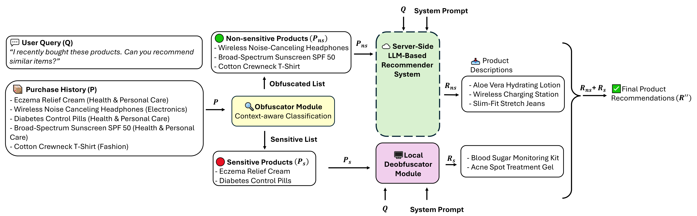
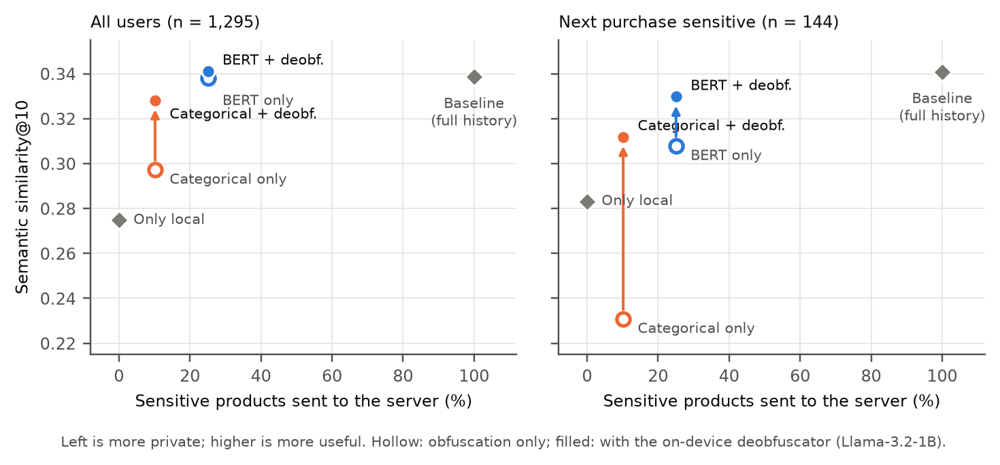
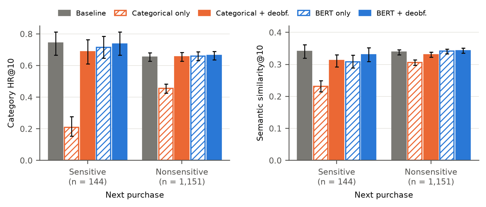

<div align="center">

# Hybrid Obfuscation and On-Device Deobfuscation

### for privacy-preserving LLM-based product recommendation

**Tina Khezresmaeilzadeh · Jiang Zhang · Dimitrios Andreadis · Konstantinos Psounis**
<br>University of Southern California

[Paper (arXiv:2505.00951)](https://arxiv.org/abs/2505.00951) ·
[Method](#how-it-works) ·
[Results](#results) ·
[Reproduce](#reproducing-the-paper) ·
[Citation](#citation)

</div>

---

Asking a cloud LLM for product recommendations means sending it your purchase history, including the glucose
monitor, the prenatal vitamins and the eczema cream. This repository implements a simple alternative: a small
classifier on the user's device decides which purchases reveal a health condition and **never sends them**. The server
recommends from everything else, and a small on-device LLM recommends for the withheld purchases. The two lists are
merged in proportion to the two parts of the history.

Every component in this repository runs locally. In our evaluation no user history leaves our machines: an open 9B model
plays the cloud recommender, and the product labels used for evaluation come from an open model with fixed prompts.

<p align="center">
  
</p>

## Highlights

- **Keeps 75% of sensitive purchases on the device**, with category hit rate and semantic similarity statistically
  indistinguishable from sending the full history (1,295 users, paired bootstrap).
- **The deobfuscator matters where it is meant to.** For users whose next purchase is sensitive, removing sensitive
  products costs relevance (semantic similarity −0.033, significant); the on-device deobfuscator closes the gap
  (−0.011, not significant).
- **Cheap on the device.** The BERT obfuscator takes 0.04 s and the Llama-3.2-1B deobfuscator 1.1 s and 2.4 GB per user
  (one RTX A6000, batch size 1).
- **Fully local, reproducible evaluation.** Open models in every role, no user data sent to any API.

## How it works

| Step | Where it runs | Model in the paper |
|---|---|---|
| **Obfuscator** splits the history into nonsensitive $P_{ns}$ and sensitive $P_s$ products | device | BERT-base, fine-tuned with a class-weighted focal loss |
| **Server recommender** produces $n_{ns}$ recommendations from $P_{ns}$ | server | any instruction-tuned LLM (Qwen3.5-9B in our runs) |
| **Deobfuscator** produces $n_s$ recommendations from $P_s$ | device | Llama-3.2-1B-Instruct (Qwen3.5-2B / 4B compared) |
| **Merge** concatenates both lists, $n_s = \mathrm{round}(n\,\lvert P_s\rvert / \lvert P\rvert)$ | device | — |

The deobfuscator runs in parallel with the server call, so it only adds latency when it is slower than the server.

## Results

1,295 Amazon users, histories of up to 20 products, 10 recommendations per user; 95% paired-bootstrap confidence intervals in
the paper.

<p align="center">
  
</p>

Deleting the three health and beauty categories exposes the fewest sensitive products (10%), but it withholds 43% of
the history and, without the deobfuscator, lowers category HR@10 from 0.662 to 0.427. The BERT obfuscator withholds
only 17% of products and stays at the baseline's utility; it exposes 25% of the sensitive products, mostly mildly
sensitive ones.

<p align="center">
  
</p>

Averaged over all users, the deobfuscator's contribution with BERT is small, because 89% of next purchases are not
sensitive. For the 144 users whose next purchase **is** sensitive, it is what keeps the recommendations relevant: BERT
obfuscation alone falls to 0.308 semantic similarity (baseline 0.341), and adding the deobfuscator brings it back to
0.330. For categorical deletion the deobfuscator raises category HR@10 for these users from 0.208 to 0.688.

<details>
<summary><b>Full results table</b> (generated from <code>results/results.csv</code>)</summary>

| Configuration | Cat@10 ↑ | Sim@10 ↑ | Ret@1k ↑ | PL<sub>b</sub> (%) ↓ | Sent (%) |
|---|---:|---:|---:|---:|---:|
| Baseline: full history to the server | 0.662 | 0.339 | 0.063 | 100.0 | 100.0 |
| Only local (Llama-3.2-1B, nothing sent) | 0.519 | 0.275 | 0.048 | 0.0 | 0.0 |
| Categorical deletion | 0.427 | 0.297 | 0.056 | 10.2 | 56.5 |
| Categorical deletion + deobfuscator | 0.658 | 0.328 | 0.061 | 10.2 | 56.5 |
| BERT obfuscation | 0.666 | 0.338 | 0.052 | 25.1 | 82.5 |
| **BERT obfuscation + deobfuscator** | 0.672 | 0.341 | 0.066 | 25.1 | 82.5 |

**Cat@10**: a recommendation's nearest catalogue product shares the target's main category ·
**Sim@10**: highest cosine similarity to the target ·
**Ret@1k**: the target ranks in the top 1,000 of 166,590 catalogue products when scored by similarity to the list ·
**PL<sub>b</sub>**: share of sensitive history products sent to the server ·
**Sent**: share of all history products sent.
</details>

## What it does not protect against

The framework guarantees that the purchases it withholds never reach the server. It does **not** stop the server from
*inferring* a condition from the purchases it does receive: harmless-looking products can be revealing in combination.
Item-level classification cannot see such patterns. Treat this as one layer of protection, not a guarantee of
attribute privacy.

## Repository layout

```
privrec/
  data.py          Amazon Reviews 2023 -> histories, targets and catalogue
  obfuscators.py   categorical rule, BERT obfuscator, split and merge counts
  llm.py           local generation with truncation handling, list parsing
  prompts.py       the four prompts of the paper (Appendix A), verbatim
  metrics.py       Cat@10, Sim@10, retrieval HR / MRR, distances, leakage, paired bootstrap
scripts/
  train_obfuscator.py   fine-tune the BERT obfuscator (focal loss)
  run_pipeline.py       labels -> obfuscation -> server and on-device recommendations (cached stages)
  evaluate.py           all metrics, paired tests and the split by target type
  make_figures.py       the figures in this README and the paper
results/                aggregate results of the paper's run (no user identifiers)
figures/
```

## Reproducing the paper

```bash
pip install -r requirements.txt

# 1. Data: download the reviews and metadata files of the ten categories from
#    https://amazon-reviews-2023.github.io/ into data/amazon2023/
#    (<Category>.jsonl and meta_<Category>.jsonl).

# 2. Obfuscator: train it on labelled products, or ask us for the trained weights.
python scripts/train_obfuscator.py --data products_labelled.jsonl --out models/bert_obfuscator

# 3. Pipeline (GPU; about 20 GPU-hours on one RTX A6000 for 1,295 users and three deobfuscators)
python scripts/run_pipeline.py --data-dir data/amazon2023 --users users.txt \
       --bert-dir models/bert_obfuscator --out runs/main

# 4. Metrics, paired bootstrap, split by target type, figures
python scripts/evaluate.py --out runs/main
python scripts/make_figures.py figures runs/main
```

`users.txt` lists one Amazon `user_id` per line. The list of the paper's 1,295 evaluation users is available from the
authors on request; any engaged users (at least 30 reviewed products in the ten categories) can be used instead.

**Hardware used:** 2× NVIDIA RTX A6000 (48 GB), AMD Ryzen Threadripper 3970X (32 cores), 128 GB RAM. All models are loaded from the Hugging Face Hub
(`Qwen/Qwen3.5-9B`, `Qwen/Qwen3.5-2B`, `Qwen/Qwen3.5-4B`, `meta-llama/Llama-3.2-1B-Instruct`,
`sentence-transformers/all-MiniLM-L6-v2`, `bert-base-uncased`). For Llama-3.2-1B we used `unsloth/Llama-3.2-1B-Instruct`, an ungated copy of the same weights.

## Citation

```bibtex
@article{khezresmaeilzadeh2025preserving,
  title   = {Preserving Privacy and Utility in {LLM}-Based Product Recommendations},
  author  = {Khezresmaeilzadeh, Tina and Zhang, Jiang and Andreadis, Dimitrios and Psounis, Konstantinos},
  journal = {arXiv preprint arXiv:2505.00951},
  year    = {2025}
}
```

## License

MIT (see [LICENSE](LICENSE)). The Amazon Reviews 2023 data are subject to their own terms.
